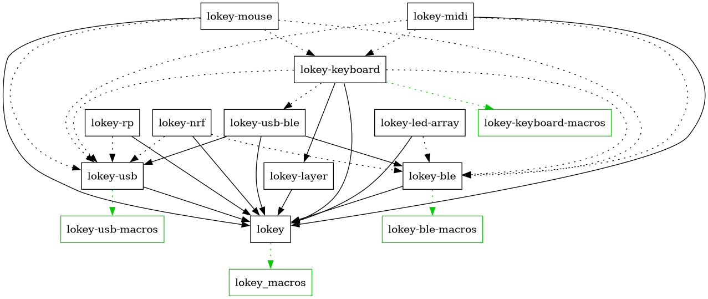

# Contributing to Lokey

Thanks for your interest in contributing to Lokey!

There are many ways you can contribute:

- Fix bugs and improve reliability
- Add or refine features
- Add support for microcontrollers
- Improve documentation (website or API docs)
- Add examples

## Development setup

### Prerequisites

- To work on the Rust crates, you will need the rust toolchain pinned in [rust-toolchain.toml](rust-toolchain.toml).

  If you use [rustup](https://rustup.rs/), run the following command in the repository directory:

  ```sh
  rustup toolchain install
  ```

  Additionally, if you are working on the `*-odyn` crates, you need to install [capnproto](https://capnproto.org/install.html) to generate the Rust bindings.

  If you want to test the code on real devices, you need to install [probe-rs](https://probe.rs/docs/getting-started/installation/) which allows you to program and debug microcontrollers via a debug probe.

- To work on the documentation website (`docs/`), you need to install [nodejs](https://nodejs.org) if you want a local preview.

- To work on the Lokey Editor (`editor/`), you need to install [nodejs](https://nodejs.org).

  Additionally, if you are working on the `lokey-editor-odyn` package, you need to install [capnproto](https://capnproto.org/install.html) to generate the TypeScript bindings.

---

Alternatively, if you use [Nix](https://nixos.org/), you can run the following command to create a shell that uses the Nix flake included in the repository with all the required packages:

```sh
nix develop
```

### Workspace overview

The `crates/` directory contains the Rust crates that make up the lokey framework:

- **`lokey`** – Core crate
- **`lokey-macros`** – Macro crate for `lokey`
- **`lokey-odyn`** – Core crate for dynamically configuring lokey devices
- **`lokey-usb`** – Feature crate for USB transports
- **`lokey-usb-macros`** – Macro crate for `lokey-usb`
- **`lokey-ble`** – Feature crate for BLE transports
- **`lokey-ble-macros`** – Macro crate for `lokey-ble`
- **`lokey-usb-ble`** – Feature crate for a combined USB and BLE transport
- **`lokey-nrf`** – Feature crate for nRF microcontroller support
- **`lokey-rp`** – Feature crate for Raspberry Pi RP2040 and RP235x microcontroller support
- **`lokey-keyboard`** – Feature crate for keyboard-related functionality
- **`lokey-keyboard-macros`** – Macro crate for `lokey-keyboard`
- **`lokey-keyboard-odyn`** – Crate for dynamically configuring keyboard functionality
- **`lokey-mouse`** – Feature crate for mouse-related functionality
- **`lokey-midi`** – Feature crate for MIDI controllers
- **`lokey-layer`** – Feature crate for managing layers
- **`lokey-led-array`** – Feature crate for a LED array component
- **`lokey-led-array-odyn`** – Crate for dynamically configuring LED array functionality

The `examples/` directory contains example projects of how to use the lokey framework.

The `docs/` contains the source code of the documentation website (hosted at https://lokey.rs).

The `editor/` directory contains the source code of the Lokey Editor web app, which makes it possible to dynamically configure Lokey devices (hosted at https://editor.lokey.rs).

### Crate dependency graph

<!--
Picture was generated with the command:

    cargo depgraph --build-deps --workspace-only --all-features | dot -Tpng > dependency-graph.png
-->



- Solid line: required dependency
- Dotted line: optional dependency
- Green: build dependency

## Formatting and linting

Format before submitting:

```sh
cargo fmt
```

Run clippy and make sure no warnings or errors are produced:

```sh
cargo clippy --workspace --exclude lokey-nrf --exclude lokey-rp --all-features
cargo clippy -p lokey-nrf --features "defmt usb ble nrf52840" --target thumbv7em-none-eabihf
cargo clippy -p lokey-rp --features "defmt usb rp2040" --target thumbv6m-none-eabi
```

> [!NOTE]
> The formatting and linting is also checked in the GitHub CI.

## Tests

The unit tests and doc tests can be run with the following commands:

```sh
cargo test --workspace --exclude lokey-nrf --exclude lokey-rp --all-features
cargo test -p lokey-nrf --features "defmt usb ble nrf52840" --target thumbv7em-none-eabihf
cargo test -p lokey-rp --features "defmt usb rp2040" --target thumbv6m-none-eabi
```

> [!NOTE]
> The tests are also checked in the GitHub CI.

## Lokey Editor

The Lokey Editor web app is built with [SolidJS](https://www.solidjs.com/) and [Ark UI](https://ark-ui.com/). It is hosted at https://editor.lokey.rs.

To run a development server, use the following commands:

```sh
cd editor/lokey-editor
npm install
npm run dev
```

Use `npm run build` for a production build.

## Documentation website

The website is built with [Fumadocs](https://www.fumadocs.dev). It is hosted at https://lokey.rs.

To run a development server, use the following commands:

```sh
cd docs
npm install
npm run dev
```

Use `npm run build` for a production build.

## Pull request guidelines

- Keep PRs focused and small when possible
- Update docs and examples when behavior changes

## License

By contributing, you agree that your work is dual-licensed under Apache-2.0 or MIT, consistent with the project licenses.
